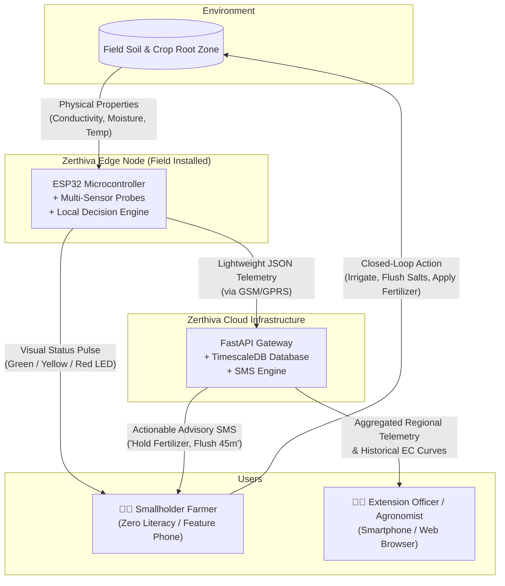
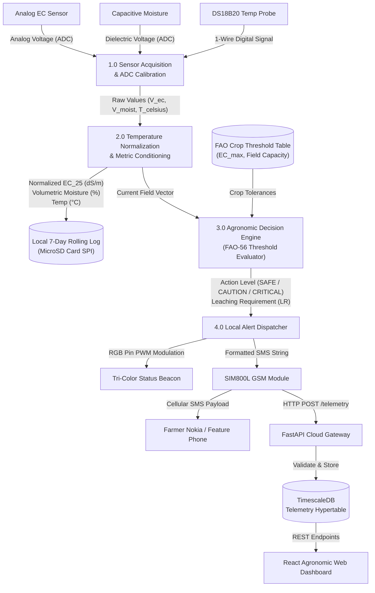
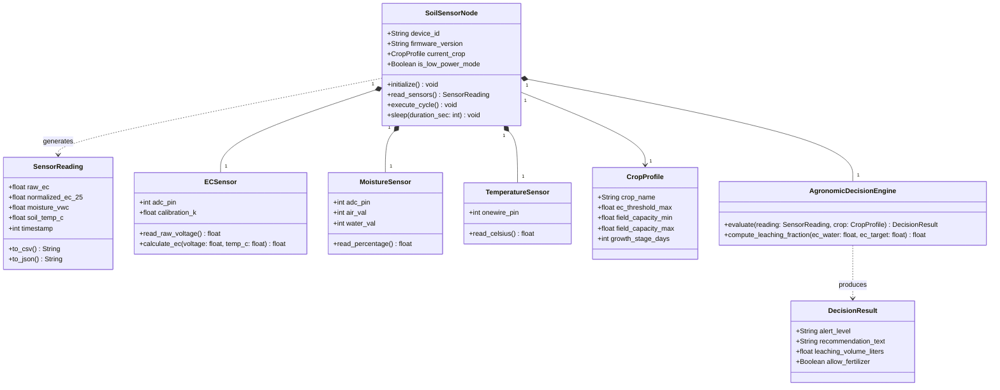
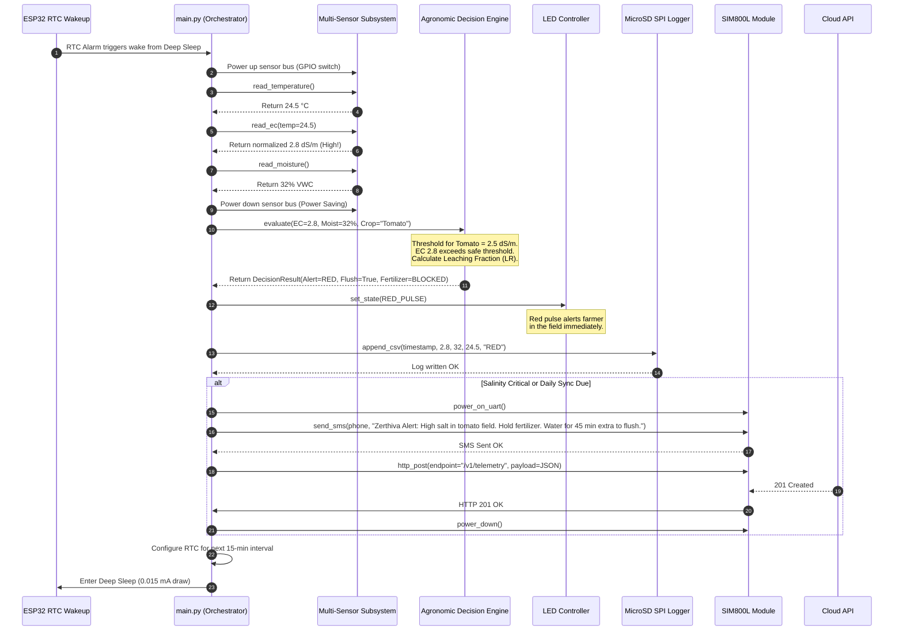
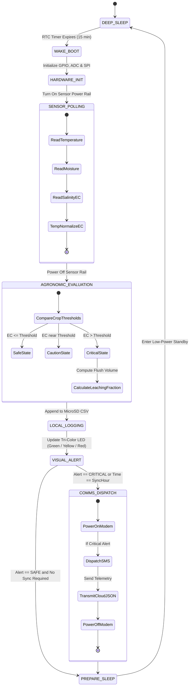
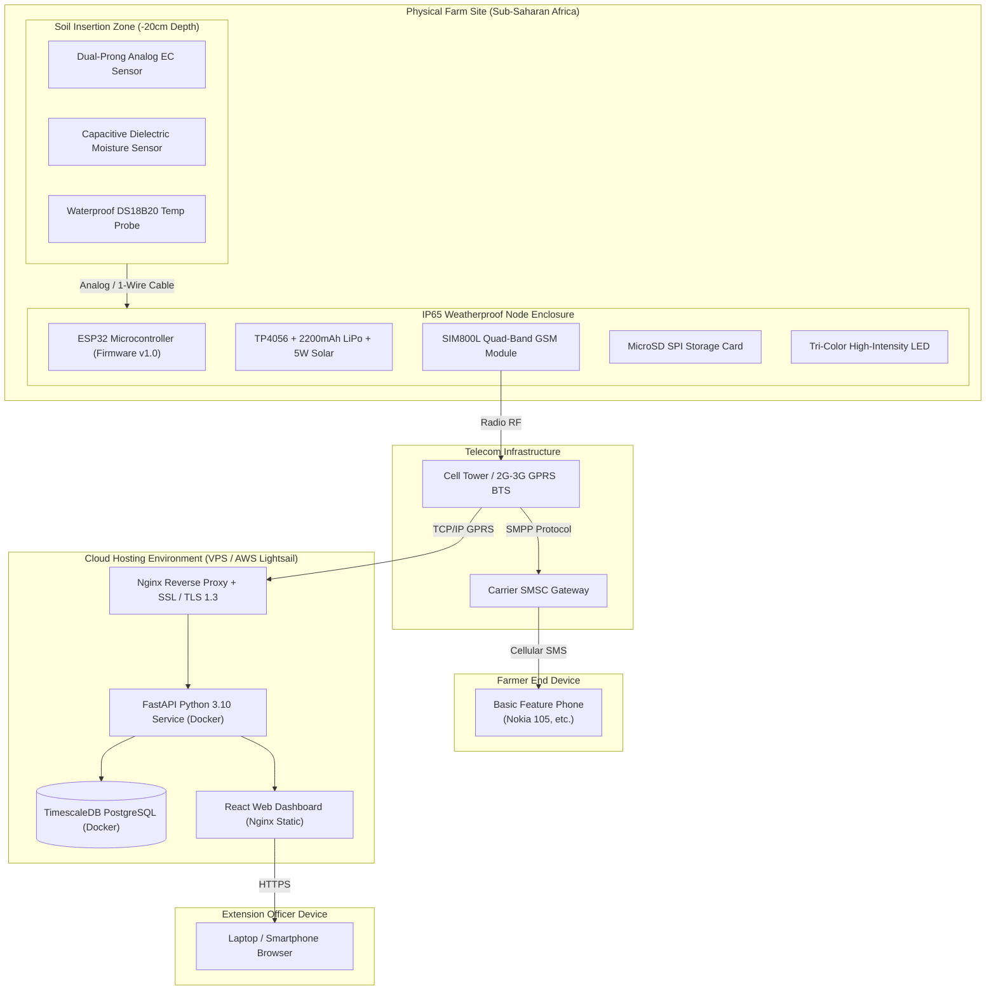

# 🛠️ Zerthiva — Technical Architecture & Codebase Blueprint

This blueprint provides the complete engineering specifications, folder hierarchy, requirements, and architectural diagrams (DFDs and UMLs) needed to build and launch the **Zerthiva Soil Intelligence System (SIS)** in a private GitHub repository.

---

## 1. Repository Directory Structure

```text
zerthiva-core/
├── .github/
│   ├── workflows/
│   │   ├── firmware-ci.yml         # Linting, syntax validation & mock tests for MicroPython
│   │   ├── backend-ci.yml          # Pytest, flake8, and container build for FastAPI
│   │   └── frontend-ci.yml         # ESLint, build test for React dashboard
│   └── PULL_REQUEST_TEMPLATE.md
│
├── firmware/                       # ESP32 Edge Firmware (MicroPython / PlatformIO)
│   ├── src/
│   │   ├── __init__.py
│   │   ├── main.py                 # Main orchestration loop, deep-sleep scheduler
│   │   ├── config.py               # Hardware pinouts, calibration constants, crop profile
│   │   ├── sensors/
│   │   │   ├── __init__.py
│   │   │   ├── ec_sensor.py        # Analog EC reading & 25°C temperature compensation
│   │   │   ├── moisture_sensor.py  # Capacitive VWC% conversion & calibration curve
│   │   │   └── temp_ds18b20.py     # OneWire digital temperature sensor driver
│   │   ├── engine/
│   │   │   ├── __init__.py
│   │   │   ├── fao_tables.py       # FAO crop salinity thresholds (Maize, Tomato, etc.)
│   │   │   ├── decision_engine.py  # Leaching fraction (LR) & fertilizer adjustment rules
│   │   │   └── led_controller.py   # Tri-color visual sentry pulse controller
│   │   ├── storage/
│   │   │   ├── __init__.py
│   │   │   └── sd_logger.py        # MicroSD SPI driver & 7-day rolling CSV writer
│   │   └── comms/
│   │       ├── __init__.py
│   │       ├── gsm_sim800.py       # SIM800L UART driver, SMS dispatcher & HTTP POST
│   │       └── wifi_client.py      # Optional WiFi uplink for bench testing
│   ├── tests/
│   │   ├── test_decision_engine.py # Mock agronomic logic tests
│   │   └── test_temperature_comp.py
│   ├── flash_firmware.sh           # Script to flash MicroPython onto ESP32 via esptool
│   └── requirements-dev.txt
│
├── backend/                        # Cloud Telemetry & Advisory API (FastAPI)
│   ├── app/
│   │   ├── __init__.py
│   │   ├── main.py                 # FastAPI application initialization & middleware
│   │   ├── core/
│   │   │   ├── config.py           # Pydantic environment settings
│   │   │   ├── database.py         # SQLAlchemy async engine & TimescaleDB connection
│   │   │   └── security.py         # JWT tokens & device PSK authentication
│   │   ├── models/                 # Database ORM entities
│   │   │   ├── farm.py             # Farm profile, crop types, GPS coordinates
│   │   │   ├── node.py             # Device hardware ID, firmware version, battery
│   │   │   └── telemetry.py        # Hypertable for EC, moisture, temp time-series
│   │   ├── schemas/                # Pydantic request/response models
│   │   │   ├── telemetry.py
│   │   │   └── advisory.py
│   │   ├── api/
│   │   │   └── v1/
│   │   │       ├── api.py          # Route registry
│   │   │       ├── endpoints/
│   │   │       │   ├── ingest.py   # IoT node telemetry ingestion endpoint
│   │   │       │   ├── farms.py    # Farm & node management
│   │   │       │   └── advisory.py # Agronomic query & alert logs
│   │   └── services/
│   │       ├── sms_gateway.py      # Africa's Talking / Twilio SMS integration
│   │       └── anomaly_detector.py # Sensor drift & outlier detection
│   ├── alembic/                    # Database schema migration scripts
│   │   └── versions/
│   ├── tests/
│   │   ├── test_ingest.py
│   │   └── test_telemetry.py
│   ├── Dockerfile
│   └── requirements.txt
│
├── frontend/                       # Extension Officer & Regional Dashboard (React + Vite)
│   ├── src/
│   │   ├── assets/
│   │   ├── components/
│   │   │   ├── StatCard.jsx        # Quick metric counters
│   │   │   ├── SalinityChart.jsx   # Time-series Recharts EC curve
│   │   │   ├── MoistureGauge.jsx   # Field capacity gauge
│   │   │   └── FarmMap.jsx         # Leaflet/OpenLayers farm status map
│   │   ├── pages/
│   │   │   ├── Dashboard.jsx       # Overview of all 10 pilot farms
│   │   │   ├── FarmDetail.jsx      # Individual field telemetry & historical logs
│   │   │   └── Alerts.jsx          # Active critical salinity warnings
│   │   ├── services/
│   │   │   └── api.js              # Axios HTTP client with JWT interceptor
│   │   ├── App.jsx
│   │   └── main.jsx
│   ├── package.json
│   ├── tailwind.config.js
│   └── vite.config.js
│
├── simulator/                      # Synthetic Sensor & Field Emulator
│   ├── __init__.py
│   ├── mock_field_node.py          # Emulates diurnal cycles, rainfall & salt spikes
│   └── run_simulation.sh
│
├── docs/                           # Technical Specifications & Schematics
│   ├── architecture/
│   │   ├── data_flow_diagrams.md
│   │   ├── uml_diagrams.md
│   │   └── circuit_schematic.png   # ESP32 pinout & wiring diagram
│   └── api/
│       └── openapi.json
│
├── docker-compose.yml              # Local dev stack: Postgres + TimescaleDB + Backend + Frontend
├── .env.example                    # Template for secrets and credentials
├── .gitignore
├── LICENSE                         # MIT License
└── README.md
```

---

## 2. Requirements & Tooling Setup

### 2.1 Hardware Lab Requirements
* **Microcontroller:** ESP32-WROOM-32 (NodeMCU / DevKit V1)
* **Salinity Probe:** Analog Soil EC/TDS Sensor (Output: 0–3.3V DC via op-amp divider)
* **Moisture Probe:** Capacitive Soil Moisture Sensor v1.2 (Corrosion-resistant)
* **Temperature Probe:** DS18B20 1-Wire Digital Probe (Requires 4.7kΩ pull-up resistor on GPIO4)
* **Storage:** MicroSD Card Module (SPI interface: CS=GPIO5, MOSI=GPIO23, MISO=GPIO19, SCK=GPIO18)
* **Status Beacon:** Tri-Color RGB Common-Cathode LED (Red=GPIO25, Green=GPIO26, Blue=GPIO27)
* **Uplink Module (Optional):** SIM800L GSM/GPRS module (UART2: TX=GPIO17, RX=GPIO16)
* **Power Supply:** 5W Monocrystalline solar panel + TP4056 charging board + 18650 3.7V 2,200mAh Li-ion cell

### 2.2 Software & Development Toolchain

#### Edge Firmware Tooling
```bash
# Python toolchain for flashing MicroPython to ESP32
pip install esptool adafruit-ampy rshell

# Erase and flash latest MicroPython firmware on ESP32
esptool.py --chip esp32 --port COM3 erase_flash
esptool.py --chip esp32 --port COM3 --baud 460800 write_flash -z 0x1000 esp32-20230426-v1.20.0.bin
```

#### Cloud Backend Tooling
```bash
cd backend
python -m venv venv
source venv/bin/activate  # On Windows: .\venv\Scripts\activate
pip install -r requirements.txt
```
*Core `requirements.txt`:*
* `fastapi>=0.104.0`
* `uvicorn[standard]>=0.23.0`
* `sqlalchemy>=2.0.0`
* `asyncpg>=0.28.0`
* `pydantic>=2.4.0`
* `alembic>=1.12.0`
* `africastalking>=1.2.0`
* `pytest>=7.4.0`

#### Dashboard Tooling
```bash
cd frontend
npm install
npm run dev
```

---

## 3. Data Flow Diagrams (DFD)

### 3.1 DFD Level 0: System Context Diagram



---

### 3.2 DFD Level 1: Subsystem Data Flow Decomposition



---

## 4. UML Diagrams

### 4.1 UML Class Diagram (Domain & Edge Architecture)



---

### 4.2 UML Sequence Diagram: 15-Minute Sensor & Decision Cycle



---

### 4.3 UML State Machine Diagram: ESP32 Edge Lifecycle



---

### 4.4 UML Deployment Diagram (Physical Infrastructure)



---

## 5. Core Mathematical & Algorithmic Starter Code

Here is the exact implementation of the **Agronomic Decision Engine** in Python, ready to be saved into `firmware/src/engine/decision_engine.py`:

```python
"""
Zerthiva Agronomic Decision Engine (FAO-56 Implementation)
Author: Zerthiva Engineering Team
License: MIT
"""

class CropTolerance:
    """FAO Salinity Tolerance Parameters (ECe in dS/m)"""
    PROFILES = {
        "maize": {
            "threshold_ec": 1.7,       # Yield loss begins above 1.7 dS/m
            "slope_percent": 12.0,      # Yield decline % per dS/m increase
            "min_moisture_vwc": 22.0,   # Refill point (% volumetric water)
            "max_moisture_vwc": 38.0    # Field capacity
        },
        "tomato": {
            "threshold_ec": 2.5,
            "slope_percent": 9.9,
            "min_moisture_vwc": 25.0,
            "max_moisture_vwc": 40.0
        },
        "rice": {
            "threshold_ec": 3.0,
            "slope_percent": 12.0,
            "min_moisture_vwc": 35.0,
            "max_moisture_vwc": 55.0
        },
        "wheat": {
            "threshold_ec": 6.0,
            "slope_percent": 7.1,
            "min_moisture_vwc": 20.0,
            "max_moisture_vwc": 35.0
        }
    }

class DecisionEngine:
    def __init__(self, ec_water_source: float = 0.6):
        """
        :param ec_water_source: EC of local irrigation water in dS/m (default 0.6 dS/m)
        """
        self.ec_water = ec_water_source

    def normalize_temperature(self, raw_ec: float, temp_c: float) -> float:
        """Standardize raw electrical conductivity to 25°C standard baseline"""
        # Standard t# Rhoades temperature compensation coefficient for soil solution EC: 1.91% per °C (verified)
        alpha = 0.0191
        normalized_ec = raw_ec / (1.0 + alpha * (temp_c - 25.0))
        return round(normalized_ec, 2)

    def calculate_leaching_requirement(self, ec_soil_target: float) -> float:
        """
        Ayers & Westcot Leaching Fraction formula (FAO-56 / FAO-29):
        LF = ECw / (5 * ECe - ECw)
        Safety constraint: enforced only when EC_w <= 0.5 * EC_e (Annex E §E.1)
        """
        # Safety guard: if irrigation water EC is >50% of soil target EC,
        # leaching would worsen salt concentration — do not advise.
        if self.ec_water > 0.5 * ec_soil_target:
            return 0.0  # No leaching advisory; consult agronomist
        denominator = (5.0 * ec_soil_target) - self.ec_water
        if denominator <= 0:
            return 0.15  # Fallback baseline 15% leaching buffer
        lr = self.ec_water / denominator
        return round(min(max(lr, 0.05), 0.45), 2)  # Clamp between 5% and 45%

    def evaluate_field(self, crop_name: str, raw_ec: float, temp_c: float, moisture_vwc: float) -> dict:
        """
        Evaluates soil metrics and produces actionable plain-language commands.
        """
        crop = CropTolerance.PROFILES.get(crop_name.lower(), CropTolerance.PROFILES["maize"])
        ec_25 = self.normalize_temperature(raw_ec, temp_c)

        is_saline = ec_25 > crop["threshold_ec"]
        is_dry = moisture_vwc < crop["min_moisture_vwc"]
        is_waterlogged = moisture_vwc > crop["max_moisture_vwc"]

        # 1. Critical Salinity Condition
        if is_saline:
            lr = self.calculate_leaching_requirement(crop["threshold_ec"])
            extra_percent = int(lr * 100)
            return {
                "status": "CRITICAL",
                "led_color": "RED",
                "allow_fertilizer": False,
                "action": "FLUSH_SALTS",
                "message": f"Hold fertilizer! Soil salt high ({ec_25} dS/m). Water with {extra_percent}% extra volume to leach salts."
            }

        # 2. Dry Soil Condition (Salinity Normal)
        if is_dry:
            return {
                "status": "IRRIGATE",
                "led_color": "YELLOW",
                "allow_fertilizer": True,
                "action": "WATER_FIELD",
                "message": f"Soil dry ({moisture_vwc}%). Salinity safe ({ec_25} dS/m). Run standard irrigation."
            }

        # 3. Waterlogged Condition
        if is_waterlogged:
            return {
                "status": "CAUTION",
                "led_color": "YELLOW",
                "allow_fertilizer": False,
                "action": "PAUSE_WATER",
                "message": f"Soil saturated ({moisture_vwc}%). Pause irrigation to prevent root hypoxia."
            }

        # 4. Optimal Balanced Condition
        return {
            "status": "OPTIMAL",
            "led_color": "GREEN",
            "allow_fertilizer": True,
            "action": "NONE",
            "message": f"All metrics balanced (EC: {ec_25} dS/m, Moisture: {moisture_vwc}%). All good."
        }
```

---

## 6. Synthetic Field Simulator (`simulator/mock_field_node.py`)

This standalone Python script simulates a deployed field node over a 30-day crop growth window. It enables backend and dashboard development before physical soldering is completed:

```python
"""
Zerthiva Field Telemetry Simulator
Generates diurnal temperature, irrigation drop/spikes, and gradual salt accumulation.
"""
import time
import math
import random
import json

def generate_telemetry_point(day: int, hour: int, base_ec: float = 1.2):
    # Diurnal temperature cycle: peak at 14:00, trough at 04:00
    temp_c = 22.0 + 8.0 * math.sin((hour - 8) * math.pi / 12) + random.uniform(-0.5, 0.5)

    # Moisture slowly drops during the day, spikes on simulated irrigation
    moisture = 34.0 - (hour * 0.4) + random.uniform(-0.3, 0.3)
    if hour == 6: # Simulated 6 AM morning irrigation
        moisture += 10.0

    # Progressive salt buildup over 30 days without leaching
    accumulated_salt = base_ec + (day * 0.045) + random.uniform(-0.05, 0.05)

    return {
        "device_id": "SG-NODE-001",
        "timestamp": int(time.time()),
        "day": day,
        "hour": hour,
        "soil_temp_c": round(temp_c, 2),
        "moisture_vwc": round(moisture, 2),
        "raw_ec": round(accumulated_salt, 2),
        "crop": "tomato"
    }

if __name__ == "__main__":
    print("Simulating Zerthiva Node Telemetry stream...")
    for d in range(1, 4):
        for h in range(0, 24, 3):
            data = generate_telemetry_point(day=d, hour=h)
            print(json.dumps(data))
```
